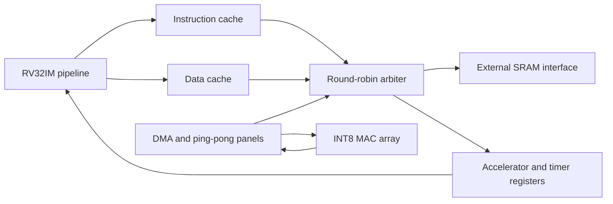

# Architecture specification

The implementation provides a machine-mode RV32IM core, separate caches,
round-robin memory arbitration, and a DMA-controlled output-stationary matrix
array. The reference project is retained under `baseline/`.

## Pipeline and ISA

Fetch uses one outstanding request and a response buffer. ID holds the fetched
instruction; EX calculates results, branches, addresses, and exceptions; MEM
holds the outstanding data transaction; WB exposes retirement and updates
architectural registers. Register bypassing and a load-use interlock preserve
dependencies. This is conservative elastic pipelining: the frontend does not
currently sustain one instruction per cycle. Measure CPI rather than assuming
an ideal five-stage throughput.

The iterative M unit uses 32 magnitude-multiply or restoring-divide steps,
including signed high products, mixed-sign products, divide-by-zero, and signed
overflow. It blocks EX. No branch predictor, speculative memory accesses, or
out-of-order execution is implemented.

Implemented ISA targets RV32I 2.1, M 2.0, Zicsr, and Zifencei semantics, with
a limited machine-only environment based on privileged ISA 1.12. Supported
CSRs: mstatus, misa (read-only RV32IM), mie, mtvec (direct/vectored), mscratch,
mepc, mcause, mtval, mip (external/timer signals, writes ignored), mcycle,
minstret, high halves, read-only cycle/instret aliases, and zero identification
CSRs. MPP remains machine-mode; unsupported mstatus/mie bits are masked.
MRET restores MIE from MPIE; WFI is a no-op. There is no supervisor/user mode,
PMP, MMU, atomics, floating point, debug module, software interrupt source,
or complete privileged extension set. Full privileged compliance is not claimed.

Exceptions include instruction/load/store misalignment, illegal instructions,
breakpoints, ECALL, and instruction/data access errors. Memory errors complete
the outstanding transaction and trap before younger instructions commit.
Interrupts drain the pipeline and outstanding fetch before entering the trap.
The memory slave must not perform writes it reports as failed.

## Memory and protocol

| Address range | Behavior |
|---|---|
| 0x00000000–0x0000ffff | Cached executable/data SRAM |
| 0x00010000–0x0003ffff | Uncached DMA RAM |
| 0x40000000–0x400000ff | Accelerator control |
| 0x40000100 / 104 | mtime low/high |
| 0x40000110 / 114 | mtimecmp low/high |
| 0x40000200 | Simulation exit/status register |
| Other addresses | Access error |

The SoC exposes the memory port; testbenches supply 256 KiB of memory with
latency and acceptance backpressure. This capacity accommodates current
workloads but is a simulation choice, not an integrated 256 KiB SRAM macro.

Every accepted request produces exactly one response, including writes. Masters
hold valid and the payload stable until ready. The port carries aligned word
reads and byte strobes for writes; CPU byte/halfword loads select/extend lanes.
Only one transaction is outstanding per master. Responses cannot be stalled.
Reset must reset the entire endpoint/fabric domain so pre-reset responses do
not appear afterward. The AXI4-Lite adapter supports independently stalled
AW/W channels and propagates AXI errors; burst AXI is not implemented.

Caches are direct mapped, default 16 lines × four words × four bytes = 256 bytes
each. Only power-of-two line counts and words per line of at least two are
supported. Data policy is write-through, no-write-allocate. MMIO and DMA RAM
bypass caches. FENCE orders operations through the in-order completion rule;
FENCE.I also redirects fetch and invalidates the instruction cache. An
in-progress invalidated refill may return data to its cancelled requester but
cannot install a valid line. There is no coherent cached DMA mapping.

## Matrix engine

TILE selects the number of parallel output rows/columns (4 or 8 tested).
PANEL_K selects the K panel depth (4, 8, and 16 tested). Two A panels and two B
panels require `4*TILE*PANEL_K` operand bytes. INT32 output accumulators require
`4*TILE*TILE` bytes. Panels are organized into logical banks but currently
synthesize to registers/muxes; physical SRAM banking is not claimed.

Each compute step updates TILE² INT32 accumulators from signed INT8 operands.
Accumulation wraps modulo 2^32. Descriptor K is at most 256, so valid INT8 GEMM
inputs cannot overflow INT32 in this implementation. Edge rows/columns/K are
zero padded and only valid output elements are stored. The other operand bank
loads during computation; transfers and MAC steps can overlap. A one-word DMA
read buffer reuses adjacent byte lanes; transfers are single word transactions.

| Register offset | Meaning |
|---|---|
| 0x00 | bit 0 start, bit 1 IRQ enable, bit 2 clear done/error |
| 0x04 | bit 0 busy, bit 1 done, bit 2 error |
| 0x10 / 14 / 18 | A / B / C byte base addresses |
| 0x1c / 20 / 24 | M / N / K |
| 0x28 / 2c / 30 | A / B / C row strides in bytes |
| 0x40 / 44 | elapsed / array-active cycles, low halves |
| 0x48 / 4c | DMA read / write bytes, low halves |

A is row-major M×K; B is K×N; C is M×N INT32. Dimensions are 1–256; row
strides must cover a row and be ≤4096 bytes. C and its stride must be word
aligned. All operand/output ranges must fit uncached RAM, and C must not overlap
A or B. A/B may share storage. Range checking conservatively includes row-end
padding. Configuration writes while busy are ignored. Invalid descriptors and
DMA errors set sticky done/error; software must inspect status. Unknown
accelerator register offsets read zero and ignore writes. Reset aborts work.

Bias, signed arithmetic right-shift requantization, saturation, and ReLU run in
firmware. The CNN uses im2col to lower convolution into GEMM. These operations
are not implemented as dedicated accelerator hardware. Weight-stationary
comparison is an executable functional/idealized traffic model, not additional
RTL. The model counts operand and spilled partial-sum bytes but predicts no
clock frequency or RTL timing.
