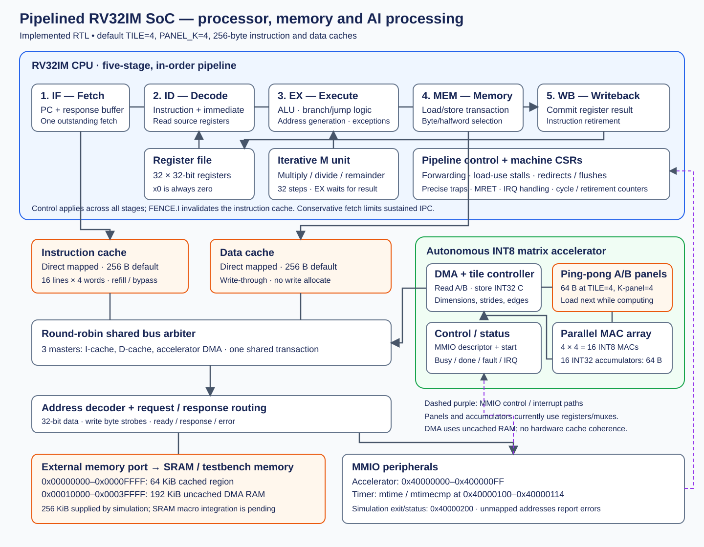

# Whole-SoC block diagram

## Follow an instruction

1. IF requests the instruction through the instruction cache.
2. ID decodes it and reads the 32-register file.
3. EX performs arithmetic, checks branches, or calculates a memory address. Multiply/divide instructions use the iterative M unit.
4. MEM completes a load/store through the data cache when needed.
5. WB commits the result and retires the instruction. Forwarding and stalls handle dependencies; traps and branch redirects flush younger work.

## Follow an accelerator job

The CPU writes an accelerator descriptor and start command through the data
port, cache bypass, arbiter and MMIO decoder. The accelerator becomes the third
bus master and fetches signed INT8 A/B operands from uncached RAM. Ping-pong
panels overlap the next transfer with computation. The default 4×4 array updates
16 INT32 accumulators per compute step and DMA writes the valid results back.
Firmware can poll completion or receive an external interrupt. The timer also
supplies its own interrupt to the CPU.

## Memory units and boundaries

| Unit | Default capacity / role |
|---|---|
| Integer register file | 32 × 32 bits; x0 fixed at zero |
| Instruction cache | 256 bytes, direct mapped |
| Data cache | 256 bytes, direct mapped, write-through/no-write-allocate |
| Accelerator operand panels | 64 bytes at TILE=4 and PANEL_K=4; two A and two B panels |
| Accelerator accumulators | 64 bytes, 16 × INT32 |
| External memory | Testbench supplies 256 KiB: 64 KiB cached + 192 KiB uncached |

The external memory is behind a SoC port, not an integrated SRAM macro. Operand
panels/accumulators synthesize to registers and muxes today. Caches and DMA
share one arbitrated memory path; there is no coherent cached DMA mapping.
The standalone AXI4-Lite adapter is available for integration but is not
instantiated in `pipelined_soc.sv`, so it is omitted from the connected diagram.
Quantization, activation functions and layer sequencing run in firmware.

See [architecture specification](ARCHITECTURE.md) for protocol and ISA limits.
