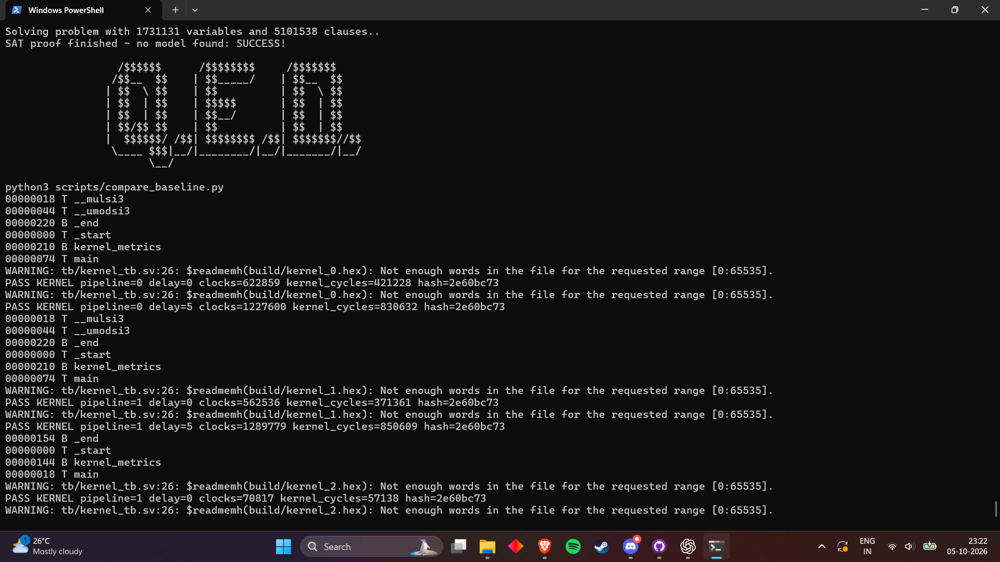

# Verification report

See [screenshot context and reproduction command](../docs/VERIFICATION.md).
The screenshot captures part of the passing run, before the final command exit.

The project regression passed 520 independently generated
multiply/divide vectors under three memory-delay configurations. Each CPU run
also passed an independent retirement-model comparison of
8176 instructions. All comparisons
run through the actual CPU executing compiler-generated firmware.

Unit checks cover cache refills/hits/write strobes/bypass/errors/invalidation;
AXI AW/W independence and response errors; eight precise exception types;
discarded younger stores; and cached self-modifying code with FENCE.I.

Matrix checks exercise six shapes per configuration, signed operands, irregular
dimensions, padded strides, descriptor rejection, and memory stalls. Integrated
tests execute software GEMM, polling DMA, interrupt DMA, timer traps, and a
complete small CNN. Python independently verifies its final output:
[-1, -1, 0].

## Architectural suite

49 imported riscv-tests RV32I/M programs passed in the adapted
bare-metal environment. This is not architectural certification. The successful
misaligned-access test is excluded because this CPU deliberately traps those
accesses. The exact results and pinned source commit are in
architectural_tests.json.

Passed: rv32ui-add, rv32ui-addi, rv32ui-and, rv32ui-andi, rv32ui-auipc, rv32ui-beq, rv32ui-bge, rv32ui-bgeu, rv32ui-blt, rv32ui-bltu, rv32ui-bne, rv32ui-fence_i, rv32ui-jal, rv32ui-jalr, rv32ui-lb, rv32ui-lbu, rv32ui-ld_st, rv32ui-lh, rv32ui-lhu, rv32ui-lui, rv32ui-lw, rv32ui-or, rv32ui-ori, rv32ui-sb, rv32ui-sh, rv32ui-simple, rv32ui-sll, rv32ui-slli, rv32ui-slt, rv32ui-slti, rv32ui-sltiu, rv32ui-sltu, rv32ui-sra, rv32ui-srai, rv32ui-srl, rv32ui-srli, rv32ui-st_ld, rv32ui-sub, rv32ui-sw, rv32ui-xor, rv32ui-xori, rv32um-div, rv32um-divu, rv32um-mul, rv32um-mulh, rv32um-mulhsu, rv32um-mulhu, rv32um-rem, rv32um-remu.

## RTL checks

Verilator lint and Yosys generic synthesis structural checks passed. The
arbiter safety properties passed bounded checking through
25 cycles under stable stalled master requests.
This is not a CPU proof, an unbounded arbiter proof, or a liveness proof.
Warnings for intentionally unused diagnostics/high bits and empty diagnostic
connections are suppressed; width/latch/undriven warnings remain fatal.

## Scope limits

No physical timing, area, power, silicon, or FPGA results are claimed. Directed
tests and randomized latency do not exhaustively verify every interrupt/reset
interleaving. The external slave must suppress side effects on failed writes
and share reset with the interconnect. SRAM macro integration remains external.
